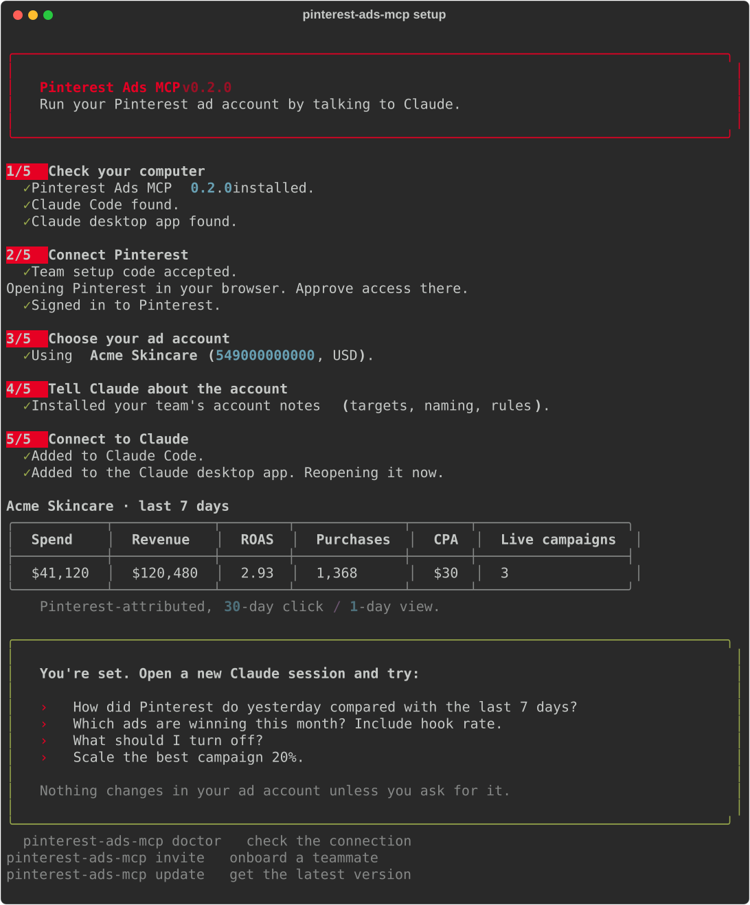
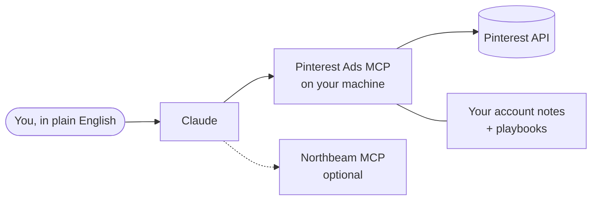
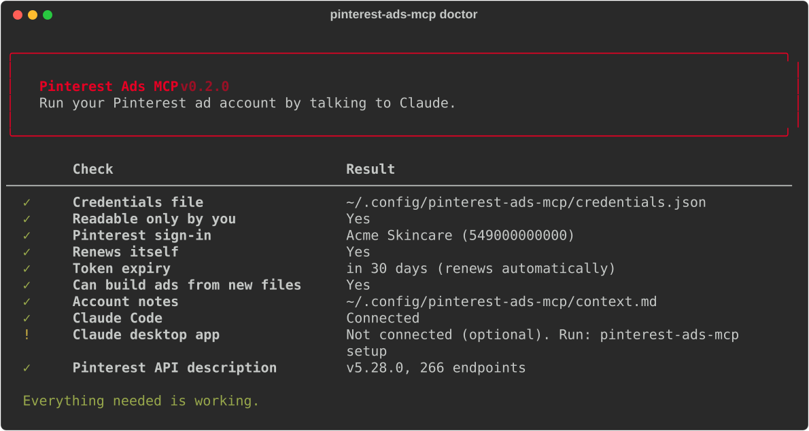
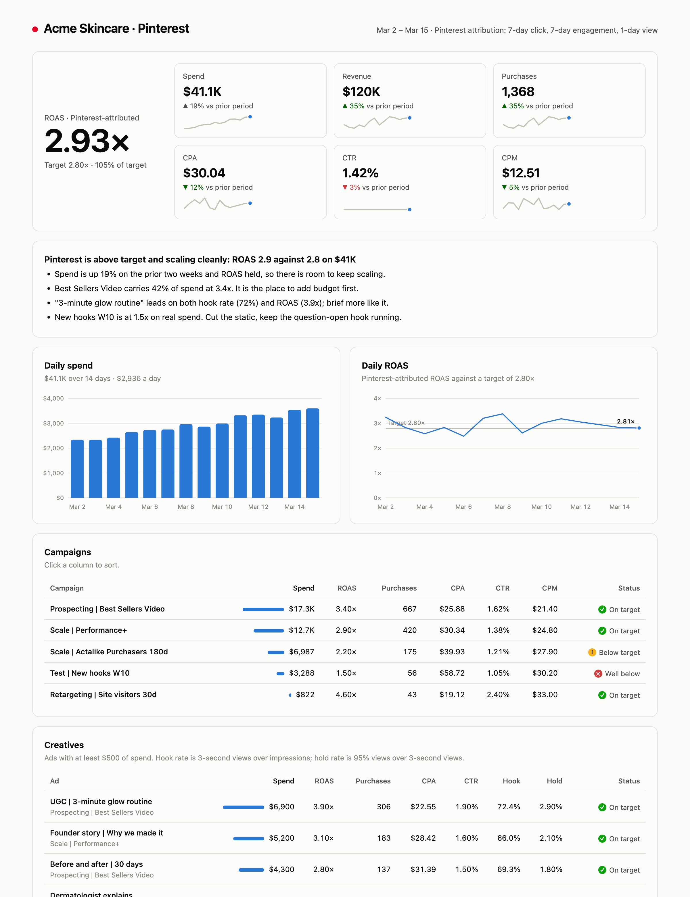

<div align="center">

<h1>Pinterest Ads MCP</h1>

<p><strong>Run your Pinterest ad account by talking to Claude.</strong></p>

<p>
Ask how the account is doing, which creatives are winning, where the budget should move.<br>
Tell it to pause an ad set, scale a campaign, or launch a new video.<br>
It answers in dollars, ROAS and CPA, and changes nothing unless you ask.
</p>

<p>


</p>

<p>
<a href="#install"><b>Install</b></a> ·
<a href="#what-you-can-ask"><b>What you can ask</b></a> ·
<a href="#for-teams"><b>For teams</b></a> ·
<a href="#launch-ads-from-a-folder"><b>Launch from a folder</b></a> ·
<a href="#reports-and-visuals"><b>Reports</b></a> ·
<a href="#works-with-northbeam"><b>Northbeam</b></a> ·
<a href="#playbooks"><b>Playbooks</b></a> ·
<a href="#tools"><b>Tools</b></a> ·
<a href="#safety"><b>Safety</b></a>
</p>

<br>



</div>

<br>

## Install

Paste this into Terminal:

```sh
curl -fsSL https://raw.githubusercontent.com/leofriend1048/Pinterest-management/mcp-server/install.sh | sh
```

That installs the `pinterest-ads-mcp` command and walks you through setup: sign
in to Pinterest in your browser, pick your ad account, and connect Claude. It
takes about two minutes.

Terminal is only needed for this one step. After it, everything happens in
**Claude Code** or the **Claude desktop app**: setup connects both, and
restarts the desktop app for you so it loads the tools. Then ask it something.

> [!TIP]
> Got a **setup code** from a teammate? Add it and you skip straight to signing in:
> ```sh
> curl -fsSL https://raw.githubusercontent.com/leofriend1048/Pinterest-management/mcp-server/install.sh | sh -s -- --code pam1_...
> ```

<details>
<summary><b>What you need first</b></summary>

<br>

- A Mac or Linux machine. On Windows, use WSL.
- [Claude Code](https://claude.com/claude-code) or the Claude desktop app.
- Access to the ad account in Pinterest Business Manager.
- Either a setup code from a teammate, or your own
  [Pinterest developer app](https://developers.pinterest.com/apps/) with
  `http://localhost:8080` as a redirect URI.

The installer adds [uv](https://docs.astral.sh/uv/) if you do not have it.
Nothing else is required.

</details>

<details>
<summary><b>Install from source instead</b></summary>

<br>

```sh
git clone https://github.com/leofriend1048/Pinterest-management.git
cd Pinterest-management
uv sync
uv run pinterest-ads-mcp setup
```

</details>

## What you can ask

```text
How did Pinterest do yesterday compared with the last 7 days?
Which ads spent over $300 in the last two weeks with ROAS under 1? Include hook rate.
Break down last month by age. Where is the money going?
Show me the top ad. What is the hook?
Should I scale Prospecting, or is it too early?
Pause the three worst ads in "Best Sellers Video".
Scale the Prospecting campaign 20%.
Put that winner in the Broad US ad set too.
Launch everything in ~/Desktop/new-hooks into Broad US, paused, with our usual landing page.
Make a new ad set like Broad US called "W10 hooks" and put the folder in that instead.
Is ad A really beating ad B, or is that noise?
Make me a report for the last two weeks I can send to the team.
```

### Why not just call the API?

Pinterest's API speaks in operation ids, micro-dollars and 626 report column
names. Media buyers speak in spend, ROAS, ad sets and "last 7 days". This server
sits between the two.

| You say | It does |
| :-- | :-- |
| "What's my ROAS this week?" | Runs the report, converts to dollars, computes ROAS, CPA, CTR, CPM, CVR and AOV, adds account totals |
| "Which creatives are working?" | Ad-level results with hook rate and hold rate |
| "The Best Sellers Video campaign" | Finds it by name and resolves the id |
| "Show me that ad" | The copy, landing page, a preview link, and the creative itself so Claude can see it |
| "Turn off that ad set" | Pauses the ad group and reports the status before and after |
| "Scale it 20%" | Reads the current daily budget and sets the new one in dollars |
| "Launch the ads in this folder" | Reads the folder, shows you the plan, then uploads each file, creates the Pins and creates the ads paused |
| "Is A really better than B?" | Runs a significance test on click-through and conversion rate, and says when there is too little data |
| "Make me a report" | Builds an interactive dashboard with its own analysis written in |
| "Is that good?" | Judges it against *your* target, from your saved account notes |
| "Should I scale this?" | Reads the budget playbook first, then the numbers |

Anything the purpose-built tools do not cover is still reachable: all 266 of
Pinterest's v5 endpoints can be searched, described and called.



## For teams

One person sets up the Pinterest app. Everyone else pastes one command and one code.

**1. The first person** runs setup with the team's Pinterest app id and secret, then:

```sh
pinterest-ads-mcp invite
```

That prints the install command and a **setup code**.

**2. Each media buyer** gets those two things, pastes the command into
Terminal, pastes the code when asked, and approves access in the browser with
their own Pinterest login.

The code carries the team's Pinterest app and account notes, so every buyer
starts with the same targets, naming conventions and rules.

> [!IMPORTANT]
> A setup code contains the Pinterest app secret. Send it privately (password
> manager or direct message), never in a public channel. It does **not** contain
> anyone's Pinterest login: each person signs in as themselves and needs their
> own access to the ad account.

### Commands

| Command | What it does |
| :-- | :-- |
| `pinterest-ads-mcp setup` | Guided setup. Safe to run again |
| `pinterest-ads-mcp doctor` | Checks every part of the connection and names the fix |
| `pinterest-ads-mcp invite` | Makes a setup code for a teammate |
| `pinterest-ads-mcp update` | Gets the latest version |

<details>
<summary><b>See <code>pinterest-ads-mcp doctor</code></b></summary>

<br>

<div align="center">

</div>

</details>

## Teach it your account

The server reads a plain-language notes file at the start of each session:

```
~/.config/pinterest-ads-mcp/context.md
```

Put your target ROAS and CPA, the attribution windows you report on, your naming
conventions, your default landing page with tracking parameters, and any rules
("never raise a budget more than 30% at once"). Setup asks for the basics, and
you can tell Claude to "update my Pinterest account context" any time.

This is what turns "is this ad good?" into an answer about your business.

## Launch ads from a folder

Point it at a folder of videos and images and say what you want:

```text
Launch everything in ~/Desktop/new-hooks into the Broad US ad set.
Name them "W10 | <file name>", use our standard landing page,
and write a title for each from the file name.
```

1. **It looks first.** Every file is listed with its size, shape and length, and
   anything Pinterest would reject is flagged.
2. **It shows you the plan.** A table of every ad it will create: name, title,
   landing page, ad set. Nothing exists on Pinterest yet.
3. **You approve, it builds.** Each file is uploaded, turned into a Pin, and
   promoted as a **paused** ad. One Pin is shared across every ad set you name.

It is safe to run twice. The folder remembers what was launched, so a run that
stopped halfway picks up where it left off and nothing is duplicated. Drop an
optional `ads.csv` in the folder (`file, name, title, description, url`) if you
would rather write the copy in a spreadsheet.

Need a fresh ad set for the batch? "Make a new ad set like Broad US" copies the
targeting, bidding and optimisation of an existing one.

## Reports and visuals

Ask for a report, a dashboard, or "something I can send", and you get one
polished, interactive page: the headline ROAS against target, KPI tiles with
change versus the prior period, daily spend and ROAS charts, sortable campaign
and creative tables with status, and spend by age. Claude writes its own
headline and findings into the top of it.

<div align="center">
<a href="docs/demo-report.html"></a>
<br><sub>Demo data. The page is one self-contained HTML file: light and dark mode, hover detail, no internet needed.</sub>
</div>

<br>

In chat, results come back as clean tables: dollars, `2.56x`, percentages,
sorted, with the account total beside them. And because a media buyer's
instincts are only as good as the sample, every row carries a **confidence**
level:

| Confidence | Purchases | What Claude will say |
| :-- | :-- | :-- |
| `low` | under 10 | Nothing about ROAS or CPA yet. It tells you how long until there is enough data |
| `directional` | 10 to 29 | A lean, stated as a lean |
| `solid` | 30 or more | A conclusion |

Before it calls a winner between two ads it tests the difference
(`pinterest_compare`), and it treats the most recent few days as incomplete,
because conversions are still arriving.

## Works with Northbeam

If the Northbeam MCP is connected in the same Claude session, the two are used
together automatically. There is nothing to configure.

| | Source |
| :-- | :-- |
| Did it make money? ROAS, revenue, CPA | **Northbeam**, the number to decide on |
| What did the platform deliver? CPM, CTR, hook rate | **Pinterest** |
| What is live, what does the creative look like | **Pinterest** |
| Pausing, budgets, launching | **Pinterest** |

Northbeam carries Pinterest's own campaign, ad set and ad ids, so rows are
joined exactly, by id. You get one table with Northbeam ROAS first and
Pinterest's beside it, each labelled, with the attribution windows stated.

> [!NOTE]
> Without Northbeam, everything still works. ROAS, purchases and revenue are
> then **Pinterest-attributed** (30-day click, 30-day engagement, 1-day view
> unless your notes say otherwise) and will not match Northbeam, Triple Whale
> or Shopify.

## Playbooks

Numbers are half of media buying. The other half is knowing what to do with
them. Six playbooks ship with the server, and Claude reads the relevant one
before it recommends anything.

| Playbook | Covers |
| :-- | :-- |
| `growth-marketer-playbook` | Triage, leading and lagging indicators, what each trend window means, diagnosing why ROAS moved, when to hold and when to act |
| `budget-optimization` | Scale, hold and cut tiers, the guards on each, minimum-spend gates, seasonal floors |
| `creative-management` | Creative lifecycle, graduating a test into scale, pause rules, decay and fatigue signals |
| `campaign-operations` | Campaign-level pauses and resumes, writing a testable hypothesis, keyword expansion |
| `attribution-northbeam` | Pairing Pinterest delivery data with Northbeam attribution |
| `analysis-and-presentation` | Decomposing a ROAS change, sample-size rules, how to write the answer, table and chart standards |

They are plain Markdown in
[`src/pinterest_ads_mcp/playbooks/`](src/pinterest_ads_mcp/playbooks). Edit them
to match how your team buys.

## Tools

<details open>
<summary><b>For media buyers</b></summary>

<br>

| Tool | Use it for |
| :-- | :-- |
| `pinterest_account_overview` | What is live, daily budgets, and results per campaign |
| `pinterest_performance` | Results by account, campaign, ad group or ad. Any date range, daily or weekly trend, split by age, gender, keyword, interest, placement, device or region |
| `pinterest_dashboard` | A shareable, interactive performance report |
| `pinterest_compare` | Test whether one ad, ad group or campaign really beats another |
| `pinterest_find` | Look up campaigns, ad groups and ads by name |
| `pinterest_creative` | See an ad: copy, landing page, preview link and the image or video cover |
| `pinterest_scan_folder` | See what is in a folder of creatives and what Pinterest would reject |
| `pinterest_launch_folder` | Turn a folder of videos and images into paused ads, plan first |
| `pinterest_duplicate_ad_group` | A new ad set with the same settings as an existing one |
| `pinterest_launch_ad` | Create one ad from an existing ad, a Pin, or a local video or image |
| `pinterest_set_status` | Pause, resume or archive |
| `pinterest_set_daily_budget` | Change a daily budget, in dollars |
| `pinterest_account_context` | Your saved targets, conventions and rules |
| `pinterest_playbook` | The decision playbooks |

</details>

<details>
<summary><b>For everything else in Pinterest's API</b></summary>

<br>

| Tool | Use it for |
| :-- | :-- |
| `pinterest_search_endpoints` | Find any of Pinterest's 266 endpoints |
| `pinterest_describe_endpoint` | Parameters and body for one endpoint |
| `pinterest_api_read` | Call any endpoint that only reads |
| `pinterest_api_write` | Call any endpoint that creates, edits or deletes |
| `pinterest_run_report` | Custom analytics report with any columns |
| `pinterest_upload_video` | Upload a local video for a new Pin |
| `pinterest_auth_status` | Check the token, scopes and ad account |

</details>

<details>
<summary><b>Ready-made workflows</b></summary>

<br>

Type <kbd>/</kbd> in Claude Code to find them.

| Workflow | What it produces |
| :-- | :-- |
| `performance_report` | The dashboard, with the analysis written in |
| `daily_check` | Yesterday against the last 7 days and against target, with up to three recommended actions |
| `creative_report` | Winners, losers and what each group has in common |
| `budget_review` | A table of proposed budget moves with the evidence, applied only after you choose |
| `launch_ads` | A folder of creatives into an ad set, paused until you approve |

</details>

## Safety

- **Nothing runs by itself.** There is no schedule and no background job.
- **Reads and writes are separate tools.** The read tools cannot change the
  account: they refuse any endpoint Pinterest's spec does not mark read-only.
  Allow the read tools freely in Claude and keep the write tools on "ask", and
  every change needs your approval.
- **Budget typos are caught.** An increase to more than double the current
  budget is refused until it is explicitly confirmed.
- **New ads start paused** unless you say to launch them.
- **Your sign-in stays on your machine**, in
  `~/.config/pinterest-ads-mcp/credentials.json` with owner-only permissions.
  It renews itself.

> [!WARNING]
> The write tools act on your live ad account and can spend money. Read what
> Claude says it is about to change before you approve it.

## Good to know

<details>
<summary><b>Dates, scopes, large results, environment variables</b></summary>

<br>

- "Last 7 days" ends yesterday, so every day in the range is complete.
- Building ads from new creative needs pin access on your Pinterest app. Setup
  asks for it and falls back to ads-only access if the app does not have it;
  reporting and edits still work. `pinterest-ads-mcp doctor` shows which you have.
- Large responses are saved under `~/.cache/pinterest-ads-mcp/` and a preview is
  returned.
- `PINTEREST_ACCESS_TOKEN` and `PINTEREST_AD_ACCOUNT_ID` in the environment
  override the credentials file.

</details>

## Development

```sh
git clone https://github.com/leofriend1048/Pinterest-management.git
cd Pinterest-management && uv sync

uv run pinterest-ads-mcp setup            # registers this checkout with Claude
uv run pytest                             # 100 tests, no network
uv run python scripts/update_spec.py      # pull Pinterest's latest API description
uv run python scripts/render_screens.py   # regenerate the README screenshots
```

<details>
<summary><b>Project layout</b></summary>

<br>

```text
src/pinterest_ads_mcp/
  buyer.py        media-buyer tools and workflows
  dashboard.py    the HTML report
  playbooks/      the decision playbooks (Markdown)
  server.py       generic tools over the whole API
  spec.py         index of Pinterest's OpenAPI description
  client.py       HTTP, token refresh, retries
  reports.py      async analytics reports
  onboarding.py   setup, doctor, invite
  oauth.py        browser sign-in
  credentials.py  token storage
  cli.py          command line entry point
install.sh        one-line installer
```

</details>

<br>

## License

[MIT](LICENSE)

<div align="center">
<sub>Not affiliated with Pinterest or Northbeam.</sub>
</div>
